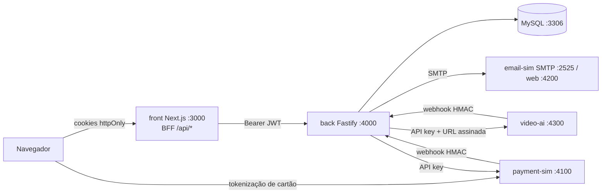
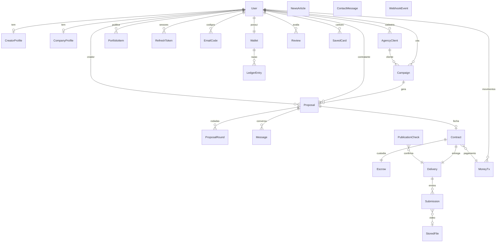

# Triskel · Escopo da versão funcional

Fonte única de funcionalidades: `reference/triskel_prototipo.html` e `reference/prototype-src` (menu.js, dl.js, ctr.js, news.js e os testes `t_*.py`). Tudo que está no protótipo vira funcional; o que não está fica fora (seção "Fora do escopo"). Textos, rótulos, valores de exemplo, dados de seed e identidade visual vêm do protótipo.

> Figma: a ferramenta do Figma foi negada nesta sessão. Home, login e cadastro foram reproduzidos a partir do protótipo, que já era fiel ao Figma (tokens: índigo `#4c5cca`, verde-água `#2dd4bf`, verde `#2dd450`/`#5fe0a1`, fundo `#f6fbfa`, botões pílula em gradiente, cartões com raio 15-20 px, logo de três pétalas "Triskel – plataforma de criadores").

## 1. Arquitetura

Portas: front 3000, back 4000, payment-sim 4100, email-sim web 4200 e SMTP 2525, video-ai 4300, MySQL 3306.

## 2. Modelo de dados (ERD)

Dinheiro sempre em **centavos inteiros**. Datas de entrega em `DATE`; carimbos em UTC, exibidos em America/Sao_Paulo.

Tabelas e campos principais

| Tabela | Campos relevantes |
|---|---|
| User | id, email (único), passwordHash (bcrypt 12), role CREATOR/BUSINESS/AGENCY, name, phone, publicId (ID do criador/comércio/agência), emailVerifiedAt, prefs (push, email, resumo), visible, avatarFileId, coverFileId, failedLogins, lockedUntil |
| EmailCode | userId, kind VERIFY/NEW_EMAIL, codeHash, newEmail, expiresAt, attempts, usedAt |
| RefreshToken | id, userId, familyId, tokenHash, expiresAt, revokedAt, replacedById, ip, userAgent |
| CreatorProfile | cpf, birthDate, gender, city, uf, languages, about, instagram, tiktok, youtube, followersBand, niches, formats, avgDelivery, priceReels/Stories/Tiktok (centavos), imageUse, showPrices, acceptBelowMin, audience*, vmin/vmax, sizeBand |
| CompanyProfile | kind BUSINESS/AGENCY, tradeName, cnpj, responsible, foundedAt, segment, size, city, uf, about, instagram, site, channels, audience*, desiredFormats, budget, creatorSizes, creatorNiches, services, teamSize, clientsRange, regions |
| AgencyClient | agencyId, name, segment |
| PortfolioItem | creatorId, title, description |
| Campaign | ownerId, clientId, brandName, segment, todos os campos do formulário do protótipo, status DRAFT/OPEN, generated (JSON), requirements (JSON) |
| Proposal | number (PR-n), campaignId, contractorId, creatorId, status OPEN/ACCEPTED/CONTRACT/DECLINED/CLOSED, origin INVITE/APPLICATION, snapshot (brand, client, segment, exclusiveDays, videos, formato), unreadCreator, unreadContractor, acceptedBy/At |
| ProposalRound | proposalId, seq, by C/K, valueCents, deliveryDate, imageUse, message |
| Message | proposalId, by C/K/S (sistema), text |
| Wallet | userId, balanceCents (disponível) |
| MoneyTx | id TRX-XXXXXXXX, kind RECHARGE/CONTRACT/WITHDRAWAL, status, valueCents, feeCents, totalCents, method, detail, idempotencyKey (único), gatewayRef, contractId |
| LedgerEntry | **imutável** (triggers bloqueiam UPDATE/DELETE): walletUserId, txId, kind, amountCents (±), balanceAfterCents |
| Escrow | contractId, amountCents, status HELD/RELEASED, releasedAt |
| Contract | number TRK-2026-NNNN, proposalId, valueCents, feeCents, totalCents, snapshot (modelo do contrato congelado), sha256, contractorSignature, creatorSignature (JSON), contractorPaidAt, pdfPath (final) |
| Delivery | contractId, state PROD/IA/APROV/APROVADO/LIBERADO, adjustCount, adjustComment, publishUrl, publishedAt |
| Submission | deliveryId, n, kind VIDEO/POST, fileId, url, durationSec, aiStatus, aiResult (JSON), aiScore, aiOk, decision, comment |
| StoredFile | ownerId, kind, storageKey aleatório, mime real, size, sha256 |
| PublicationCheck | deliveryId, url, state PENDING/CONFIRMED/FAILED, runAt |
| Review | authorId, targetUserId, stars, tags, comment (única por autor+alvo) |
| SavedCard | userId, gatewayRef (referência do cofre do gateway), brand, last4, exp, holder. Nunca número nem CVV |
| NewsArticle | slug, category, publishedAt, readMins, title, summary, paragraphs |
| ContactMessage | protocol, name, email, profile, subject, message |
| DataRequest | userId, kind EXPORT/DELETE (botões "Baixar meus dados" e "Excluir minha conta") |
| WebhookEvent | source, eventId (único), receivedAt |

## 3. Máquinas de estado

**Proposta** — `OPEN` (turno alterna K/C a cada rodada) → `ACCEPTED` (aceite de quem tem o turno) → `CONTRACT` (contratante paga com a carteira). `OPEN` → `DECLINED` (criador recusa) ou `CLOSED` (contratante encerra). Aceite, contraproposta, pagamento e assinatura revalidam exclusividade.

**Contrato / assinatura** — pagamento cria Contract + Escrow + MoneyTx e registra a assinatura do contratante (dados congelados nesse instante). Se faltarem CPF/cidade do criador, a assinatura do contratante fica pendente e o contrato só é congelado quando o criador completa o perfil e assina (a assinatura do contratante guarda o horário do pagamento, como no `signAs` do protótipo). Criador assina com aceite expresso → PDF final com as duas assinaturas, e-mail com anexo às duas partes. Antes disso só minuta com marca d'água.

**Entrega** — `PROD` →(envio com IA ok)→ `IA` →(criador envia ao contratante)→ `APROV` →(contratante aprova)→ `APROVADO` →(criador informa link, plataforma confirma)→ `LIBERADO`. Análise com falha volta a `PROD` (não segue ao contratante). Pedido de ajustes: `APROV`→`PROD`, máx. 2.

**Transação** — recarga: `PENDENTE` → `CONCLUIDO` | `RECUSADO` | `EXPIRADO`. Contrato: `CUSTODIA` → `LIBERADO`. Saque: `PROCESSANDO` → `CONCLUIDO` | `FALHOU` (estorna o saldo).

## 4. Contratos de integração

Assinatura de webhooks (ambos os sentidos): cabeçalhos `X-Triskel-Timestamp` (segundos), `X-Triskel-Event-Id`, `X-Triskel-Signature: sha256=<hex(HMAC_SHA256(secret, timestamp + "." + corpoBruto))>`. Janela de 5 min, comparação em tempo constante, deduplicação por `eventId` em `WebhookEvent`. Retentativas do emissor: 6 tentativas com backoff exponencial (1 s, 2 s, 4 s...).

**back → payment-sim** (`Authorization: Bearer <PAYMENT_API_KEY>`)
- `POST /v1/charges` `{ amountCents, method: "pix"|"card", externalRef, cardToken? }` → `{ id, status, pix?: { payload, expiresAt }, action?: { type: "3ds", id } }` (idempotente por `externalRef`).
- `GET /v1/charges/:id`; `POST /v1/charges/:id/3ds {code}`.
- `POST /v1/payouts { amountCents, pixKey, externalRef }`.
- Navegador → payment-sim (chave pública, CORS): `POST /v1/tokens` com o cartão; devolve token de uso único (10 min). O back nunca vê nem guarda número de cartão.
- Painel: `GET /` (UI) e `POST /admin/charges/:id/{pay|decline|expire}`, `POST /admin/payouts/:id/{complete|fail}` (chave de administração).
- Webhook → `POST {back}/webhooks/payments`: `charge.paid`, `charge.failed`, `charge.expired`, `payout.completed`, `payout.failed`, com `data` = a cobrança/saque completo do gateway (`{ id, status, method, amountCents, externalRef, pix?, card?, failure?, ... }`; para saque, `{ id, status, amountCents, externalRef, reason? }`). O back só usa `externalRef`, `amountCents` e, nos cartões, `card.ref`; se `amountCents` diverge do valor registrado, o evento é ignorado e logado.
- Cartões de teste (do protótipo): `4111111111111111` e `5555555555554444` aprovam; `4000000000003220` pede 3-D Secure (código 123456, 3 tentativas); `4000000000000002` recusado (05); `4000000000009995` saldo/limite insuficiente (51); `4000000000000069` vencido (54); `4000000000000127` CVV incorreto (N7).

**back → video-ai** (`Authorization: Bearer <VIDEOAI_API_KEY>`): `POST /v1/jobs { jobId, videoUrl (URL assinada e curta do back), briefing, requirements: [{id,label}], callbackUrl }` → 202. Resultado por webhook `analysis.completed` `{ jobId, ok, score, summary, engine, metrics, requirements: [{ id, status: "ok"|"atencao"|"falha", evidence, suggestion }] }`. Os 8 requisitos (REQI do protótipo): logo nos primeiros 10 s, produto apresentado, mensagem principal citada, menção à marca, duração máxima de 60 s, formato vertical 9:16, conteúdo humanizado (mín. 60%), qualidade técnica.

**back → email-sim**: SMTP simples (nodemailer) para `email-sim:2525`. API REST de teste em `email-sim:4200/api/messages`.

E-mails enviados (somente eventos que o protótipo mostra ou implica): código de verificação (cadastro e troca de e-mail), nova proposta, contraproposta, proposta aceita, contrato pago/confirmado, contrato assinado com PDF anexo, entrega enviada para aprovação, entrega aprovada, pagamento liberado, pedido de ajustes, recarga concluída, confirmação dos pedidos "Baixar meus dados" e "Excluir minha conta".

## 5. Endpoints (back, prefixo `/api/v1`, OpenAPI em `/docs`)

Auth: `POST /auth/register`, `/auth/login`, `/auth/refresh`, `/auth/logout`, `/auth/verify-email`, `/auth/resend-code`; `GET /auth/me`.
Conta (`/me`): `PATCH /me/profile`, `/me/prices` (criador), `/me/phone`, `/me/prefs`; `POST /me/email/request`, `/me/email/confirm`, `/me/password`, `/me/photo/:kind`, `/me/data-request`; portfólio `GET/POST /me/portfolio`, `DELETE /me/portfolio/:id` (criador); clientes `GET/POST /me/clients` (agência).
Criadores: `GET /creators` (busca, filtros, compatibilidade e conflito de exclusividade por campanha), `GET /creators/:id`.
Campanhas (contratantes): `GET /campaigns/defaults`, `GET/POST /campaigns`, `POST /campaigns/preview`, `GET/PUT/DELETE /campaigns/:id`, `POST /campaigns/:id/confirm` (rascunho vira aberta, com os requisitos que a IA vai conferir). Oportunidades (criador): `GET /opportunities`, `GET /opportunities/:id`, `POST /opportunities/:id/apply`.
Propostas: `GET /proposals`, `GET /proposals/:id`, `POST /proposals` (campanha + criadores + condições), `POST /proposals/:id/{accept|decline|counter|messages}`.
Contratos: `GET /proposals/:id/contract` (resumo e minuta), `POST /proposals/:id/pay`, `GET /contracts/:id`, `POST /contracts/:id/sign`, `GET /contracts/:id/pdf`.
Carteira: `GET /wallet`, `POST /wallet/recharges`, `GET /wallet/recharges/:id`, `POST /wallet/recharges/:id/3ds`, `POST /wallet/withdrawals`, `GET /wallet/transactions/:id`, `DELETE /wallet/cards/:id`. Recarga e saque aceitam o cabeçalho `Idempotency-Key`.
Entregas: `GET /deliveries`, `GET /deliveries/:id`, `POST /deliveries/:id/{submissions|send|approve|adjust|publish}` (envio é multipart com vídeo ou JSON `{url}` com link de post).
Avaliações: `GET /reviews/candidates`, `GET /reviews/received`, `POST /reviews`. Painel: `GET /dashboard`.
Público: `GET /meta` (opções dos formulários), `GET /news`, `GET /news/:slug`, `POST /contact`, `GET /health`.
Arquivos: `GET /files/:id` (autenticado; fotos para qualquer usuário logado, vídeo só para as partes do contrato, com `Range`), `GET /internal/files/:id?exp&sig` (URL assinada e curta, usada pelo video-ai).
Webhooks: `POST /webhooks/payments`, `POST /webhooks/video-ai`.

## 6. Matriz de papéis × rotas

| Área | CRIADOR | COMÉRCIO | AGÊNCIA | Público |
|---|---|---|---|---|
| Home, notícias, institucional, login, cadastro | sim | sim | sim | sim |
| Buscar oportunidades / candidatar-se | sim | não | não | não |
| Buscar criadores, criar campanha, enviar proposta | não | sim | sim | não |
| Clientes | não | não | sim | não |
| Portfólio, editar valores, saque | sim | não | não | não |
| Recarga de saldo, pagar contrato | não | sim | sim | não |
| Contatos, contratos, entregas, avaliações | sim (suas) | sim (suas) | sim (suas) | não |
| Aprovar entrega / pedir ajustes | não | sim (dono) | sim (dono) | não |
| Enviar vídeo / publicar | sim (criador do contrato) | não | não | não |

Toda rota de recurso checa propriedade (usuário é parte da proposta/contrato/entrega); acesso a recurso de outro usuário responde 404.

## 7. Regras de negócio implementadas (resumo)

Taxa de 10% por cima (criador recebe o valor cheio; quebra valor/taxa/total em proposta, contraproposta e contrato); bloqueio de vazamento no servidor (`leak`, mesma lista do protótipo); exclusividade só com contrato assinado pelas duas partes, janela inclusiva `[entrega, entrega + dias]`, ramos iguais ou relacionados (Saúde/Beleza/Esportes), empresas diferentes, nos dois sentidos, validada em busca, proposta, candidatura, aceite, pagamento e assinatura, sem revelar a marca concorrente ao contratante; carteira com ledger imutável, custódia, liberação só após aprovação + publicação confirmada, saque mínimo R$ 10,00, recarga entre R$ 20,00 e R$ 10.000,00; contrato de 11 cláusulas, SHA-256, assinaturas com código de autenticação, PDF final por pdf-lib; entrega com IA, 2 rodadas de ajuste, regex de link (POSTRX).

## 8. Decisões onde o protótipo é ambíguo (escolha mais simples)

1. **Simulações do protótipo** ("simular resposta do criador", "simular pagamento") viram o mundo real: a outra parte age com a própria conta; o pagamento Pix é confirmado no painel do payment-sim.
2. **Campanhas abertas** (lista do criador): são as campanhas dos contratantes com status OPEN (o comércio/agência escolhe "publicar para candidaturas" ao gerar a campanha). O seed traz as 8 campanhas do protótipo.
3. **Criadores do seed** (Lucas, Bianca, Juliana, Rafael, Camila, Thiago, Pedro) e contratantes de apoio (Pizzaria Forno a Lenha, Café Lume, Estética Aurora etc.) são usuários reais do seed, todos com senha de demonstração `Triskel@2026`.
4. **Compatibilidade** (%) usa as mesmas fórmulas `compat`/`ccompat` do protótipo (regras, não IA); o rótulo "IA" do protótipo é mantido nos textos.
5. **Análise de vídeo**: sem `ANTHROPIC_API_KEY` o video-ai usa regras determinísticas sobre ffprobe/ffmpeg; com chave, adiciona análise semântica de frames por LLM. Entrega por link de post passa pela mesma tela, com requisitos de vídeo marcados como "atenção" (não verificáveis).
6. **Confirmação da publicação** é um job (`PublicationCheck`) executado pelo próprio back após `PUBLICATION_CHECK_DELAY_MS`; o verificador é uma interface (`PublicationVerifier`), a implementação simulada valida o padrão do link. Não há acesso real ao Instagram/TikTok.
7. **Perfil incompleto do criador no pagamento**: segue o protótipo (assinatura do contratante pendente, ver seção 3). Dados do contratante incompletos bloqueiam o pagamento.
8. **Campos "Push" e "Resumo semanal"** em Configurações são preferências salvas; não há envio push nem resumo semanal real (o protótipo só tem os interruptores).
9. **Fale Conosco** grava a mensagem e devolve o protocolo; não envia e-mail.
10. **Dinheiro**: `INT` em centavos (limite ~R$ 21 milhões por valor/saldo, suficiente ao escopo).
11. **Hash do contrato**: SHA-256 do JSON canônico do modelo (número, data, blocos), como no protótipo.
12. **Migrações**: o binário do Prisma não pôde ser baixado neste ambiente (binaries.prisma.sh bloqueado); o SQL de `prisma/migrations` foi gerado por `scripts/gen-migration.mjs` a partir do DMMF, no formato do `prisma migrate`. Em máquina com rede, `npx prisma migrate dev` valida contra o schema.

13. **Seed e perfis completos**: para os usuários do seed continuarem aparecendo nas buscas depois do primeiro login (a visibilidade é recalculada pelo perfil), todos os criadores e as duas contas de demonstração têm perfil completo e fotos de perfil/capa geradas (degradê nas cores da marca). Dados que o protótipo não traz (CPF, data de nascimento, CNPJ e responsável dos contratantes de apoio, audiência dos criadores além da Marjorie, Instagram do Thiago) são fictícios e válidos (dígitos verificadores corretos).
14. **Campanhas por trás das propostas PR-1..PR-9** que não estão entre as 8 abertas ficam como **rascunho** no seed, para a lista de oportunidades do criador mostrar exatamente as 8 campanhas do protótipo. Pelo fluxo normal toda campanha com convite está aberta.
15. **Carteira do seed**: os lançamentos são os do protótipo (TRX-1A9QXM3P ... TRX-8WQ1MR4C) mais o saldo inicial dos contratantes dos contratos PR-8 e PR-9. Saldos resultantes: Marjorie R$ 150,00 (R$ 430 liberados menos o saque de R$ 280), Doce Vale R$ 268,00, Maré Digital R$ 850,00. Pagamentos históricos sem contrato (ex.: TRX-8WQ1MR4C "em custódia" da agência) aparecem no extrato, mas não somam na custódia, que é calculada a partir dos contratos reais. O cartão salvo do protótipo não existe no seed: cartão salvo só nasce de uma compra real (referência do cofre do gateway).
16. **Contrato**: e-mail e Instagram da outra parte não entram no contrato (a plataforma não expõe contato entre as partes). Número `TRK-<ano>-<número da proposta com 4 dígitos>`.
17. **IA**: `aiOk` = nenhum requisito com status `falha`; "atenção" não bloqueia (o contratante decide). O motor determinístico não vê o conteúdo do vídeo, então itens de conteúdo ficam "atenção: conferir manualmente", nunca "ok" nem "falha".
18. **Avaliações**: a tela mostra estrelas, etiquetas mais citadas e comentários (o protótipo tem barras por critério; sem esses critérios no fluxo de envio, as barras viram contagem de etiquetas). A nota exibida no painel e na busca é `CreatorProfile.ratingAvg` (valor do protótipo no seed); a primeira avaliação real recalcula a média só com as avaliações gravadas.
19. **Campos do formulário de campanha** (nome, produto, mensagem...) não passam pelo bloqueio de contato, como no protótipo; ele vale para mensagens, termos de proposta e comentários de ajuste.
20. **Cartão**: o navegador tokeniza direto no payment-sim com a chave pública; o back nunca vê número nem CVV.
21. **Objetivos de campanha do seed** como "Gerar consultas" e "Divulgar serviços" (que o protótipo usa nas campanhas de exemplo) não estão na lista de objetivos do formulário; eles aparecem como texto nas campanhas do seed.
22. **Custódia e taxa**: ao pagar o contrato, o contratante é debitado do total (valor + 10%); a custódia (escrow) guarda só o valor do criador e a taxa fica com a Triskel. É isso que a tela de carteira mostra em "Em custódia" (valor do criador). Pagar duas vezes a mesma proposta é idempotente (devolve o contrato existente, sem novo débito).
23. **Front, tema escuro**: implementado por inversão de cores com contra-filtro em imagens/avatares/botões em gradiente (como no protótipo), escolhido em Configurações e guardado no `localStorage` (`triskel-theme`); sem tema do sistema.
24. **Front, home**: a faixa "Personalize sua busca" é estática (como no protótipo); o bloco de contato da home leva a `/fale-conosco`.
25. **Front, fluxo de campanha**: criar rascunho em `/campanhas/nova` → `/campanhas/[id]` (campanha gerada + requisitos editáveis) → "Confirmar e buscar criadores" abre a busca já com a campanha (`/criadores?campanha=`). Comércio envia a proposta a um criador por vez; a agência marca vários na busca e envia de uma vez (`/criadores/proposta?campanha=&c=id1,id2`). Para a agência, o cliente é obrigatório.
26. **Front, "Abrir meu e-mail"** na validação de e-mail aponta para a caixa do email-sim (`NEXT_PUBLIC_EMAILSIM_URL`); é só para a demonstração.
27. **Front, BFF**: tokens nunca chegam ao JavaScript. Cookies `tk_at` (acesso), `tk_rt` (refresh, só em `/api`) e `tk_session` (papel, lido pelo middleware), todos httpOnly e SameSite=Lax; `Secure` via `COOKIE_SECURE`. "Lembrar-me" decide entre cookie de 14 dias e cookie de sessão. O proxy `/api/bff/*` só repassa prefixos de uma lista fechada, exige `Origin` do próprio site (ou `APP_ORIGINS`) em métodos que alteram dados e renova o token de forma serializada.
28. **Front, rotas por papel** (middleware): Criador: `/oportunidades`, `/portfolio`, `/pagamentos/saque`, `/perfil/valores`; Comércio e Agência: `/criadores`, `/campanhas`, `/pagamentos/adicionar`; só Agência: `/clientes`. Fora disso, redireciona para `/painel`.
29. **Rate limit atrás do BFF**: o back usa o IP repassado em `X-Forwarded-For` (`trustProxy`). Sem proxy reverso na frente do front, todos os logins chegam ao back com o IP do front. Em produção, ponha um proxy que defina `X-Forwarded-For` e restrinja o back à rede interna.

## 9. Fora do escopo (não prototipado)

Não implementado porque não existe no protótipo:
- **Recuperação de senha por e-mail** e tela de redefinição (o link "Esqueci minha senha" existe no login, mas só exibe um aviso; aqui exibe aviso honesto de indisponibilidade).
- **Estorno/reembolso** de pagamentos e de custódia; disputa de entregas; cancelamento de contrato (a cláusula 8 do contrato é texto).
- Papel de administrador, painel administrativo, moderação, gestão de notícias (as notícias vêm do seed).
- Antifraude como resultado de cartão (o protótipo tem 7 cartões de teste, sem antifraude).
- Push real, resumo semanal por e-mail, envio de e-mail do Fale Conosco.
- Login social, 2FA, upload de portfólio com mídia (o portfólio do protótipo é título + descrição).
- Verificação real de post em rede social e integração real de gateway/SMTP.

## 10. Limitações do ambiente

Docker: o daemon sobe, mas o registro (`registry-1.docker.io`) é bloqueado; as imagens não puderam ser baixadas e `docker compose up` não foi executado aqui. MySQL real indisponível; usado **MariaDB 10.11** (apt) como banco de testes de integração (Prisma `provider = "mysql"`, adaptador `@prisma/adapter-mariadb`).

## Fidelidade ao protótipo e ao Figma (revisão de novembro/2026)

O front foi revisado tela a tela contra o protótipo HTML e o Figma (capturas lado a lado a 412 px).

- **Home, login e cadastro** seguem as medidas do Figma. As telas usam um "palco" de 412 px cujas medidas escalam com a largura (`front/src/components/Stage.tsx`); no desktop o palco cresce até 560 px e fica centralizado.
- **Cabeçalho e menu**: cabeçalho de 120 px com logo e botão hambúrguer; gaveta de 247 px com avatar, ID mascarado, submenu Perfil e selo de mensagens novas em Contatos. Não há barra de navegação inferior.
- **Fidelidade deliberada** (cópia do Figma, podem ser mudados a pedido): botão do cadastro com o texto "Entrar"; terceira coluna do endereço rotulada "Cidade" com "Brasil" (somente leitura, não enviada); "Politica de privacidade" sem acento no rodapé; chip "Tipo de Conteúdo" repetido na faixa de filtros; link "Esqueci minha senha" em turquesa claro (contraste baixo).
- **Formulário de contato da home** usa o mesmo endpoint `POST /contact` (assunto "Dúvida sobre a plataforma", perfil "Ainda não tenho conta").
- **Dados de demonstração**: o seed gera foto e capa no estilo do protótipo (verde-água para criadores, índigo para comércios, laranja para agências).
- **Painéis**: indicadores com os rótulos e dicas do protótipo (ex.: "Campanha ativa · Entrega em 25/11", "Propostas enviadas · 1 respondeu"), cartão de saldo no painel de comércio/agência.
